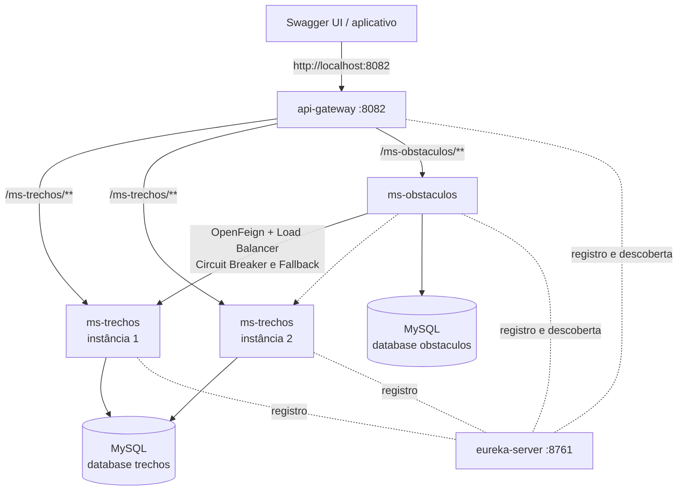
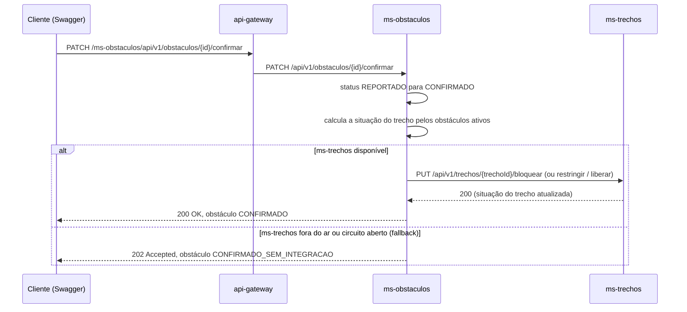

# RotaLivre

**Mobilidade urbana acessível para cadeirantes e pessoas com mobilidade reduzida.**

Global Solution 2026/2 – CitizenTech · Microservice and Web Engineering & IT Services · 3º SIS
Profª Aparecida F. Castello Rosa

## Integrantes

| Nome | RM |
| --- | --- |
| Andre Pilatis | RM555897 |
| Maria Eduarda Oliveira | RM558970 |
| Julia Sawaia | RM555438 |

## Problema

Para quem usa cadeira de rodas, andador ou muletas, o caminho mais curto quase nunca é o caminho possível. Um buraco, uma esquina sem rampa, um carro parado na calçada ou uma obra sem passagem alternativa podem impedir um trajeto simples, como ir até a padaria ou ao ponto de ônibus. Os aplicativos de rotas tradicionais calculam tempo e distância, mas não sabem em que condição está cada calçada.

Segundo o IBGE (PNAD Contínua 2022), o Brasil tem cerca de 18,6 milhões de pessoas com deficiência.

## Solução

O **RotaLivre** é um sistema colaborativo que mantém um mapa da acessibilidade das calçadas. A cidade é dividida em **trechos** (o pedaço de uma rua entre duas esquinas), e cada trecho tem uma situação:

| Situação | Significado |
| --- | --- |
| `LIVRE` | Sem obstáculos ativos: pode entrar na rota |
| `RESTRITO` | Há obstáculos que dificultam a passagem (gravidade `BAIXA` ou `MEDIA`) |
| `BLOQUEADO` | Há obstáculo que impede a passagem de uma cadeira de rodas (gravidade `ALTA`) |

Os **obstáculos** chegam de duas origens: relatos da comunidade e sensores IoT simples instalados nas cadeiras de rodas, que registram desníveis e impactos com a latitude e a longitude do ponto. Depois da vistoria, o obstáculo é confirmado e a situação do trecho é atualizada na hora. Quando a zeladoria resolve o problema, o trecho volta a ficar livre. Com isso, a rota pode ser traçada por segurança e acessibilidade, e não só por tempo.

A solução é formada por dois microsserviços:

- **ms-trechos**: cadastro e consulta dos trechos e da situação de acessibilidade de cada um.
- **ms-obstaculos**: registro dos obstáculos (com latitude e longitude), vistoria, resolução e descarte. Ao confirmar ou resolver um obstáculo, chama o ms-trechos por **OpenFeign** para atualizar a situação do trecho.

ODS atendidos: **ODS 10** (Redução das desigualdades) e **ODS 11** (Cidades e comunidades sustentáveis).

## Arquitetura



| Componente | Porta | Papel |
| --- | --- | --- |
| `eureka-server` | 8761 | Service discovery (projeto de aula) |
| `api-gateway` | 8082 | Rotas dinâmicas pelo Eureka, Load Balancer e Swagger dinâmico (projeto de aula) |
| `ms-trechos` | aleatória (`server.port=0`) | Trechos e situação de acessibilidade; sobe em várias instâncias |
| `ms-obstaculos` | aleatória (`server.port=0`) | Obstáculos e chamada síncrona ao ms-trechos |
| MySQL 8.4.6 (Docker) | 3306 | Um database independente para cada microsserviço: `trechos` e `obstaculos` |

Nenhum endereço fixo é usado entre os serviços: o gateway cria as rotas a partir dos nomes registrados no Eureka e o Feign usa `@FeignClient("ms-trechos")`.

Fluxo da confirmação de um obstáculo:



## Tecnologias

- Java 25 e Spring Boot 4.0.9 nos quatro projetos (Spring Cloud 2025.1.4)
- Spring Web MVC, Spring Data JPA, Bean Validation e Lombok nos microsserviços
- Spring Cloud Netflix Eureka (server e client), Spring Cloud Gateway (WebFlux) e Spring Cloud LoadBalancer
- Spring Cloud OpenFeign e Resilience4j (Circuit Breaker e Fallback)
- MySQL 8.4.6 no Docker, com migrations do Flyway (tabelas e carga inicial)
- H2 em memória no profile `test`
- SpringDoc OpenAPI 3.1.0 (Swagger UI), com Swagger dinâmico no gateway
- Docker Compose e Dockerfiles multi-stage
- Maven Wrapper (`mvnw`): não é preciso ter o Maven instalado

## Estrutura do repositório

```
.
├── docker-compose.yml   MySQL (padrão) e, com o profile "completo", todos os serviços
├── eureka-server/
├── api-gateway/
├── ms-trechos/
└── ms-obstaculos/
```

Organização de cada microsserviço:

```
src/main/java/br/com/fiap/ms_<servico>/
├── client/       interface OpenFeign (só no ms-obstaculos)
├── config/       OpenApiConfig (Swagger)
├── controller/   endpoints REST /api/v1/... com ResponseEntity
├── dto/          DTOs de entrada (RequestDto) e de saída (ResponseDto)
├── entities/     entidade JPA e enums
├── exceptions/   exceções customizadas, DTOs de erro e GlobalExceptionHandler
├── repositories/ Spring Data JPA
└── service/      regras de negócio
src/main/resources/
├── application.properties        configuração comum (profile ativo: dev)
├── application-dev.properties    MySQL + Flyway
├── application-test.properties   H2 em memória
├── import.sql                    carga de dados do profile test
└── db/migration/                 V1__create_table_..., V2__insert_...
```

## Como executar

### Pré-requisitos

- **JDK 25**. Pelo terminal, o `JAVA_HOME` precisa apontar para ele (`java -version` deve mostrar 25). No IntelliJ, selecione o JDK 25 em *File > Project Structure > SDK*.
- **Docker Desktop** (Docker Compose v2).
- Portas livres: **3306** (MySQL), **8761** (Eureka) e **8082** (Gateway).

### 1. Subir o MySQL

Na raiz do repositório:

```bash
docker compose up -d
docker compose ps
```

Sem informar profile, o compose sobe **só o MySQL** (container `rotalivre-mysql`, imagem `mysql:8.4.6`, usuário `root`, senha `root`, porta 3306). Aguarde o status `healthy`.

Não é preciso criar nada no banco: cada microsserviço cria o próprio database (`createDatabaseIfNotExist=true`) e o Flyway cria as tabelas e a carga inicial na primeira execução.

> Se a porta 3306 já estiver em uso por outro MySQL 8 com usuário `root` e senha `root` (por exemplo, o container `mysql_846` das aulas), pule este passo: os microsserviços usam esse MySQL e criam os databases `trechos` e `obstaculos` nele. Para usar o container do projeto, pare o outro antes (`docker stop mysql_846`).

### 2. Subir os serviços

Suba nesta ordem, esperando cada um terminar de iniciar (`Started ...Application` no log):

1. `eureka-server`
2. `api-gateway`
3. `ms-trechos` (duas instâncias, para testar o Load Balancer)
4. `ms-obstaculos`

**IntelliJ IDEA**
1. *File > Open* e selecione a pasta raiz do repositório. Se o IntelliJ não carregar os quatro projetos Maven sozinho, clique com o botão direito no `pom.xml` de cada pasta e escolha *Add as Maven Project*.
2. Execute `EurekaServerApplication`, `ApiGatewayApplication`, `MsTrechosApplication` e `MsObstaculosApplication`.
3. Para a segunda instância do ms-trechos: *Run > Edit Configurations > MsTrechosApplication > Modify options > Allow multiple instances* e execute `MsTrechosApplication` mais uma vez.

**Terminal** (um terminal para cada serviço, partindo da raiz do repositório):

```powershell
# Windows (PowerShell)
cd eureka-server;  .\mvnw.cmd spring-boot:run
cd api-gateway;    .\mvnw.cmd spring-boot:run
cd ms-trechos;     .\mvnw.cmd spring-boot:run   # em outro terminal, repita para a 2ª instância
cd ms-obstaculos;  .\mvnw.cmd spring-boot:run
```

```bash
# Linux / macOS (se preciso, antes: chmod +x */mvnw)
cd eureka-server && ./mvnw spring-boot:run
cd api-gateway && ./mvnw spring-boot:run
cd ms-trechos && ./mvnw spring-boot:run
cd ms-obstaculos && ./mvnw spring-boot:run
```

Inicie a segunda instância do ms-trechos só depois que a primeira terminar de subir, porque as duas usam a mesma pasta `target`.

Os microsserviços sobem com o profile `dev` (MySQL), definido em `spring.profiles.active=dev`.

### 3. Acessar

- **Eureka**: http://localhost:8761. Devem aparecer `API-GATEWAY`, `MS-OBSTACULOS` e `MS-TRECHOS` (duas instâncias).
- **Swagger UI** (pelo gateway): http://localhost:8082/swagger-ui/index.html. No canto superior direito, em *Select a definition*, escolha `ms-trechos` ou `ms-obstaculos`. Todos os endpoints podem ser executados pelo *Try it out*.
- **OpenAPI em JSON**: http://localhost:8082/ms-trechos/v3/api-docs e http://localhost:8082/ms-obstaculos/v3/api-docs

O gateway consulta o Eureka a cada 10 segundos. Logo depois de subir um serviço, espere alguns segundos até a rota e a definição dele aparecerem no Swagger.

### Opção: tudo em containers

O mesmo `docker-compose.yml` sobe a arquitetura inteira com o profile `completo`. Nesse modo não é preciso ter o JDK instalado:

```bash
docker compose --profile completo up -d --build
```

Sobem o MySQL, o Eureka (8761), o Gateway (8082), duas réplicas do ms-trechos e o ms-obstaculos. A primeira execução demora alguns minutos, porque cada imagem é compilada com Maven dentro do Docker. Os microsserviços continuam em porta aleatória dentro dos containers e o acesso é pelo gateway, como no modo local. Não use este modo junto com os serviços rodando pelo IntelliJ ou pelo terminal, porque as portas 8761 e 8082 são as mesmas.

Para parar, informe o profile, senão os serviços dele continuam rodando:

```bash
docker compose --profile completo down       # para tudo
docker compose --profile completo down -v    # para tudo e apaga os dados do MySQL
```

### Profile test (H2)

Para rodar um microsserviço sem MySQL, use o profile `test` (H2 em memória, carga pelo `import.sql`, Flyway desligado):

```powershell
.\mvnw.cmd spring-boot:run "-Dspring-boot.run.profiles=test"
```

O console do H2 fica em `http://localhost:<porta-da-instância>/h2-console` (JDBC URL `jdbc:h2:mem:testdb`, usuário `sa`, sem senha). O teste `contextLoads` de cada microsserviço também usa esse profile, então `mvnw package` funciona sem o MySQL.

## Banco de dados

| Microsserviço | Database | Tabela | Migrations |
| --- | --- | --- | --- |
| ms-trechos | `trechos` | `tb_trecho` | `V1__create_table_tb_trecho.sql`, `V2__insert_tb_trecho.sql` |
| ms-obstaculos | `obstaculos` | `tb_obstaculo` | `V1__create_table_tb_obstaculo.sql`, `V2__insert_tb_obstaculo.sql` |

Os dois databases são independentes. O obstáculo guarda apenas o `trecho_id` (sem chave estrangeira entre bancos), e é o ms-trechos que confirma, pela chamada síncrona, se o trecho existe.

Para consultar os dados direto no MySQL (por exemplo, a latitude e a longitude dos obstáculos):

```bash
docker exec -it rotalivre-mysql mysql -uroot -proot
```

```sql
SELECT id, trecho_id, tipo, gravidade, latitude, longitude, status, data_registro FROM obstaculos.tb_obstaculo;
SELECT id, logradouro, bairro, status, data_atualizacao FROM trechos.tb_trecho;
```

As datas ficam gravadas em UTC (`serverTimezone=UTC`) e a API devolve no horário local.

**Carga inicial** (dados fictícios de São Paulo, com coordenadas aproximadas; as datas são relativas ao momento em que o banco é criado):

| Trecho | Logradouro (entre) | Bairro | Situação |
| --- | --- | --- | --- |
| 1 | Avenida Paulista (Rua Pamplona e Alameda Joaquim Eugênio de Lima) | Bela Vista | `LIVRE` |
| 2 | Rua Augusta (Avenida Paulista e Rua Luís Coelho) | Consolação | `BLOQUEADO` |
| 3 | Rua da Consolação (Rua Maria Antônia e Rua Dona Antônia de Queirós) | Consolação | `RESTRITO` |
| 4 | Rua Galvão Bueno (Rua dos Estudantes e Rua São Joaquim) | Liberdade | `LIVRE` |
| 5 | Rua Teodoro Sampaio (Rua Henrique Schaumann e Rua Oscar Freire) | Pinheiros | `LIVRE` |
| 6 | Rua Treze de Maio (Rua Santo Antônio e Rua São Domingos) | Bela Vista | `LIVRE` |

| Obstáculo | Trecho | Tipo | Gravidade | Origem | Status |
| --- | --- | --- | --- | --- | --- |
| 1 | 4 | `RAMPA_INEXISTENTE` | `ALTA` | `SENSOR_IOT` | `REPORTADO` |
| 2 | 5 | `VEICULO_NA_CALCADA` | `BAIXA` | `COMUNIDADE` | `REPORTADO` |
| 3 | 2 | `OBRA` | `ALTA` | `COMUNIDADE` | `CONFIRMADO` |
| 4 | 3 | `CALCADA_IRREGULAR` | `MEDIA` | `SENSOR_IOT` | `CONFIRMADO` |
| 5 | 6 | `ENTULHO` | `MEDIA` | `COMUNIDADE` | `DESCARTADO` |
| 6 | 1 | `BURACO` | `MEDIA` | `SENSOR_IOT` | `RESOLVIDO` |
| 7 | 2 | `CALCADA_IRREGULAR` | `BAIXA` | `COMUNIDADE` | `CONFIRMADO` |

A situação inicial dos trechos é coerente com os obstáculos: o trecho 2 está bloqueado pela obra (obstáculo 3) e o trecho 3 está restrito pela calçada irregular (obstáculo 4).

## Endpoints

Todos são acessados pelo gateway: `http://localhost:8082/<serviço><caminho>`.

### ms-trechos (`/ms-trechos`)

| Método | Caminho | Descrição | Respostas |
| --- | --- | --- | --- |
| GET | `/api/v1/trechos` | Lista os trechos; filtro opcional `?status=LIVRE`, `RESTRITO` ou `BLOQUEADO` | 200, 400 |
| GET | `/api/v1/trechos/{id}` | Busca por id | 200, 400, 404 |
| POST | `/api/v1/trechos` | Cadastra (situação inicial `LIVRE`) | 201 + `Location`, 400, 422 |
| PUT | `/api/v1/trechos/{id}` | Atualiza os dados (a situação não é alterada) | 200, 400, 404, 422 |
| DELETE | `/api/v1/trechos/{id}` | Exclui, se o trecho estiver `LIVRE` | 204, 404, 409 |
| PUT | `/api/v1/trechos/{id}/bloquear` | Situação `BLOQUEADO` (chamado pelo ms-obstaculos via OpenFeign) | 200, 404 |
| PUT | `/api/v1/trechos/{id}/restringir` | Situação `RESTRITO` (chamado pelo ms-obstaculos via OpenFeign) | 200, 404 |
| PUT | `/api/v1/trechos/{id}/liberar` | Situação `LIVRE` (chamado pelo ms-obstaculos via OpenFeign) | 200, 404 |
| GET | `/api/v1/trechos/port` | Porta da instância que respondeu (teste do Load Balancer) | 200 |

### ms-obstaculos (`/ms-obstaculos`)

| Método | Caminho | Descrição | Respostas |
| --- | --- | --- | --- |
| GET | `/api/v1/obstaculos` | Lista os obstáculos; filtro opcional `?trechoId=2` | 200, 400 |
| GET | `/api/v1/obstaculos/{id}` | Busca por id | 200, 400, 404 |
| POST | `/api/v1/obstaculos` | Registra com latitude e longitude (status inicial `REPORTADO`) | 201 + `Location`, 400, 422 |
| PUT | `/api/v1/obstaculos/{id}` | Atualiza os dados, se ainda estiver `REPORTADO` | 200, 400, 404, 409, 422 |
| DELETE | `/api/v1/obstaculos/{id}` | Exclui, se não contar mais na situação do trecho | 204, 404, 409 |
| PATCH | `/api/v1/obstaculos/{id}/confirmar` | Confirma após a vistoria e atualiza o trecho (OpenFeign) | 200, 202, 404, 409 |
| PATCH | `/api/v1/obstaculos/{id}/resolver` | Registra a resolução e atualiza o trecho (OpenFeign) | 200, 202, 404, 409 |
| PATCH | `/api/v1/obstaculos/{id}/descartar` | Descarta um relato não encontrado na vistoria | 200, 404, 409 |

Códigos de erro: **400** para JSON malformado, enum inexistente ou parâmetro com tipo errado; **404** para recurso inexistente (inclusive um trecho inexistente ao confirmar ou resolver um obstáculo); **409** para operação que a situação atual não permite; **422** para dados inválidos, com a lista `errors` informando o campo e a mensagem. Todos seguem o formato `{"timestamp", "status", "error", "path"}`.

## Regras de negócio

**Ciclo de vida do obstáculo**

| Operação | Status permitido | Novo status | Chama o ms-trechos? |
| --- | --- | --- | --- |
| Cadastro (POST) | – | `REPORTADO` | Não |
| Alteração (PUT) | `REPORTADO` | (mantém) | Não |
| Confirmar | `REPORTADO`, `CONFIRMADO_SEM_INTEGRACAO` | `CONFIRMADO` (ou `CONFIRMADO_SEM_INTEGRACAO` no fallback) | Sim |
| Resolver | `CONFIRMADO`, `CONFIRMADO_SEM_INTEGRACAO`, `RESOLVIDO_SEM_INTEGRACAO` | `RESOLVIDO` (ou `RESOLVIDO_SEM_INTEGRACAO` no fallback) | Sim |
| Descartar | `REPORTADO` | `DESCARTADO` | Não |
| Excluir (DELETE) | `REPORTADO`, `RESOLVIDO`, `DESCARTADO` | – | Não |

- O status não faz parte do DTO de entrada: o sistema define o status inicial e as mudanças acontecem pelas operações acima.
- A data do registro é definida no cadastro e a data da resolução, ao resolver.

**Situação do trecho**

Sempre que um obstáculo é confirmado ou resolvido, o ms-obstaculos considera **todos** os obstáculos ativos do trecho (`CONFIRMADO` e `CONFIRMADO_SEM_INTEGRACAO`) e chama o endpoint correspondente do ms-trechos:

- algum obstáculo ativo com gravidade `ALTA` → `PUT /bloquear` (trecho `BLOQUEADO`);
- obstáculos ativos só de gravidade `BAIXA` ou `MEDIA` → `PUT /restringir` (trecho `RESTRITO`);
- nenhum obstáculo ativo → `PUT /liberar` (trecho `LIVRE`).

Assim, um trecho só volta a ficar livre quando o último obstáculo dele é resolvido. Exemplo da carga inicial: ao resolver a obra (obstáculo 3), o trecho 2 passa de `BLOQUEADO` para `RESTRITO`, porque o obstáculo 7 continua ativo; ao resolver o obstáculo 7, ele fica `LIVRE`.

- O cadastro (POST) e a alteração (PUT) de um trecho não mudam a situação: ela só muda pelos obstáculos, via comunicação síncrona.
- Um trecho `RESTRITO` ou `BLOQUEADO` não pode ser excluído (409).

## Comunicação síncrona, Load Balancer, Circuit Breaker e Fallback

- **OpenFeign**: `TrechoClient` (`@FeignClient("ms-trechos")`) chama `PUT /api/v1/trechos/{trechoId}/bloquear`, `/restringir` e `/liberar`. Se o ms-trechos responder 404, o ms-obstaculos devolve 404 ("Trecho não encontrado") e o obstáculo não muda de status.
- **Load Balancer**: o Spring Cloud LoadBalancer distribui as chamadas do Feign e do gateway entre as instâncias registradas no Eureka. Cada instância sobe em porta aleatória (`server.port=0`) com um `instance-id` próprio. O endpoint `/api/v1/trechos/port` mostra a alternância.
- **Circuit Breaker**: a instância `atualizarTrecho` do Resilience4j fica nos endpoints `confirmar` e `resolver` do `ObstaculoController`. Ela avalia as 3 últimas chamadas e abre o circuito quando metade falha (mínimo de 2 chamadas). O circuito fica aberto por 50 segundos e depois testa novamente. Só falhas de comunicação com o ms-trechos (`FeignException`) contam como falha; as regras de negócio (404 e 409) não abrem o circuito.
- **Fallback**: com o ms-trechos fora do ar ou o circuito aberto, o obstáculo não fica parado. Ele é gravado como `CONFIRMADO_SEM_INTEGRACAO` ou `RESOLVIDO_SEM_INTEGRACAO` e a resposta é **202 Accepted**. Para concluir a integração, basta repetir a mesma operação quando o ms-trechos voltar. A próxima atualização bem-sucedida do mesmo trecho também conclui as pendências dele, porque a situação enviada já considera esses obstáculos.

## Roteiro de teste pelo Swagger

Os passos usam a carga inicial e podem ser feitos em sequência no Swagger UI do gateway.

| # | Definição | Requisição | Resultado esperado |
| --- | --- | --- | --- |
| 1 | ms-trechos | `GET /api/v1/trechos` | 6 trechos: o 2 `BLOQUEADO`, o 3 `RESTRITO` e os demais `LIVRE` |
| 2 | ms-trechos | `GET /api/v1/trechos/port` (várias vezes) | A porta alterna entre as duas instâncias |
| 3 | ms-obstaculos | `POST /api/v1/obstaculos` com o exemplo do Swagger (buraco de gravidade `ALTA` no trecho 6) | 201, header `Location` e status `REPORTADO` |
| 4 | ms-obstaculos | `PATCH /api/v1/obstaculos/{id}/confirmar` com o id do passo 3 | 200 e status `CONFIRMADO` |
| 5 | ms-trechos | `GET /api/v1/trechos/6` | Trecho 6 passou de `LIVRE` para `BLOQUEADO` |
| 6 | ms-obstaculos | `PATCH /api/v1/obstaculos/2/confirmar` (veículo na calçada, `BAIXA`) | Trecho 5 passa para `RESTRITO` |
| 7 | ms-obstaculos | `PATCH /api/v1/obstaculos/3/resolver` (obra) | 200 e status `RESOLVIDO`; trecho 2 passa para `RESTRITO` |
| 8 | ms-obstaculos | `PATCH /api/v1/obstaculos/7/resolver` | Trecho 2 fica `LIVRE` |
| 9 | ms-obstaculos | `PATCH /api/v1/obstaculos/3/confirmar` | 409: obstáculo já resolvido |
| 10 | ms-trechos | `DELETE /api/v1/trechos/6` | 409: trecho bloqueado não pode ser excluído |
| 11 | ms-trechos | `GET /api/v1/trechos/999` e `POST /api/v1/trechos` com `"latitude": 100` | 404 e 422 |

**Circuit Breaker e Fallback**

1. Pare as duas instâncias do ms-trechos (botão *Stop* do IntelliJ ou `Ctrl+C` no terminal).
2. Confirme o obstáculo 1 (`PATCH /api/v1/obstaculos/1/confirmar`, rampa inexistente no trecho 4). A resposta é **202** com status `CONFIRMADO_SEM_INTEGRACAO`.
3. Registre e confirme outro obstáculo. Depois de duas falhas o circuito abre, e as próximas chamadas vão direto para o fallback, sem tentar o ms-trechos.
4. Resolva o obstáculo 4 (`PATCH /api/v1/obstaculos/4/resolver`): **202** com status `RESOLVIDO_SEM_INTEGRACAO`. O trecho 3 continua `RESTRITO` até a integração ser concluída.
5. Suba de novo o ms-trechos e aguarde cerca de 1 minuto (o circuito fica 50 s aberto e a lista de instâncias é atualizada a cada 10 s).
6. Repita a confirmação do obstáculo 1 e a resolução do obstáculo 4: as respostas passam a ser **200**, o trecho 4 fica `BLOQUEADO` e o trecho 3 fica `LIVRE`.

Se um serviço for encerrado à força (sem passar pelo *Stop* do IntelliJ ou pelo `Ctrl+C`), ele só sai do Eureka quando o prazo do registro expira. Nesse caso, espere cerca de 2 minutos.

## Premissas

- Os dados da carga inicial (endereços, coordenadas e descrições) são fictícios.
- O envio dos sensores IoT é simulado pelo próprio `POST /api/v1/obstaculos`, com `"origem": "SENSOR_IOT"`. Um front-end ou aplicativo pode usar `GET /api/v1/trechos?status=LIVRE` para montar rotas só com trechos livres.
- O Eureka Server e o API Gateway são os projetos de aula, atualizados para o Spring Boot 4.0.9 (o gateway era 3.5.13 e o Eureka, 4.0.7). As mudanças foram:
  - no gateway, o Swagger dinâmico (`DynamicSwaggerConfig`) e a atualização da lista de instâncias a cada 10 s;
  - no Eureka, a autopreservação desligada no ambiente local, para tirar do registro as instâncias encerradas à força.
